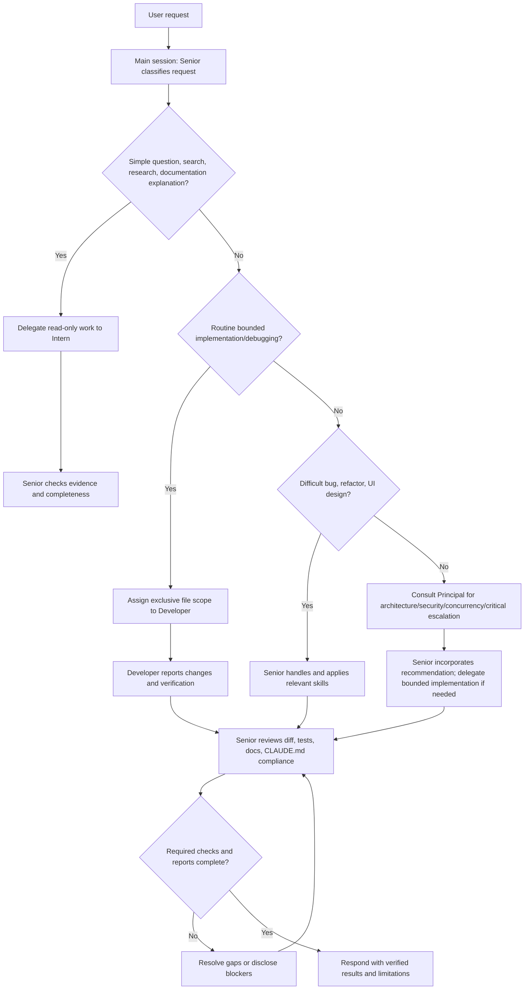
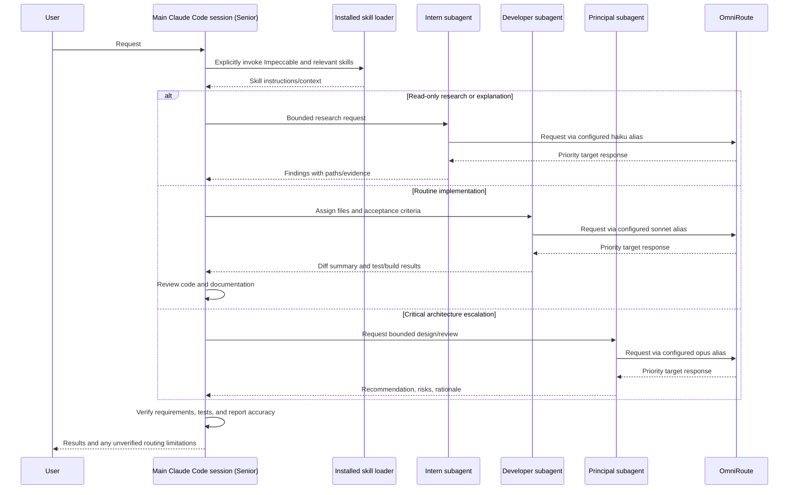

# Four-Tier AI Engineering Team — Flowcharts

## Request Handling

## Claude Code and OmniRoute Sequence

## Routing Facts
- OmniRoute aliases are priority combos; the selected backend can vary with fallback availability.
- `free-smart` has GPT-6 Luna Medium first and Nemotron Ultra second, so it is not a guaranteed Ultra route.
- The main-session model cannot be forced to Nemotron Ultra by the current project instruction file. A direct verified route is a follow-up requirement.
