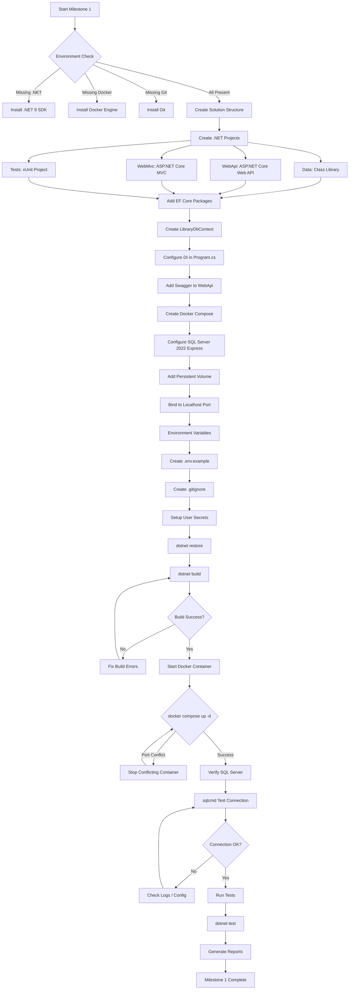
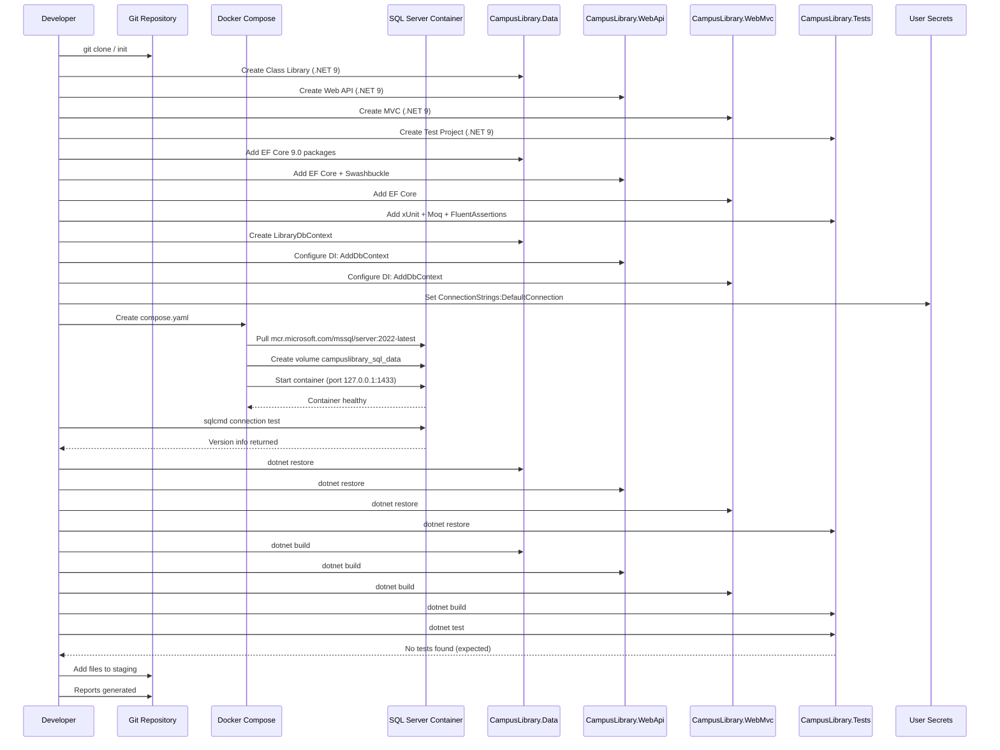
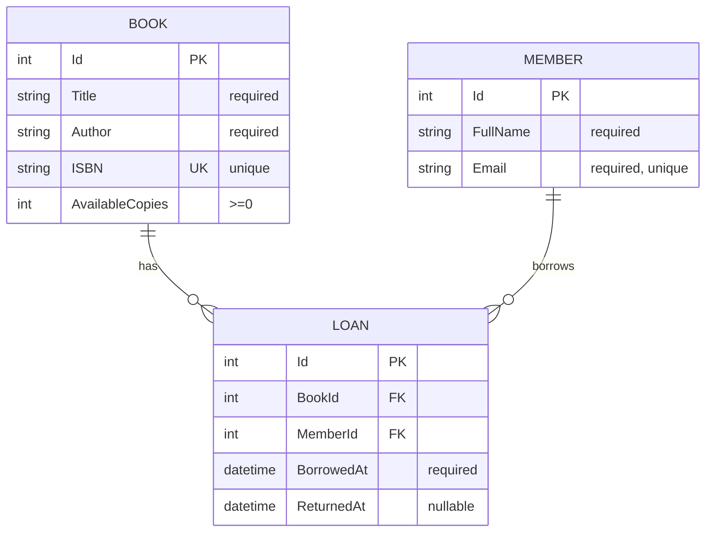
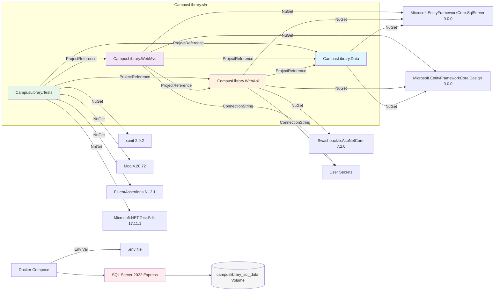
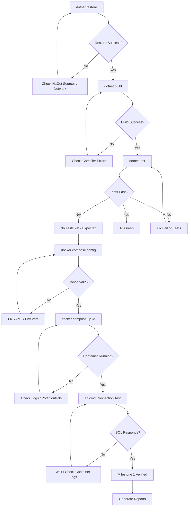

# Flowcharts — Milestone 1 Initial Setup

## Feature Logic Flowchart

## Sequence Diagram — Component Communication

## ER Diagram — Initial Database Schema (Planned for Milestone 2)

## Project Dependency Diagram

## Build and Verification Flow

