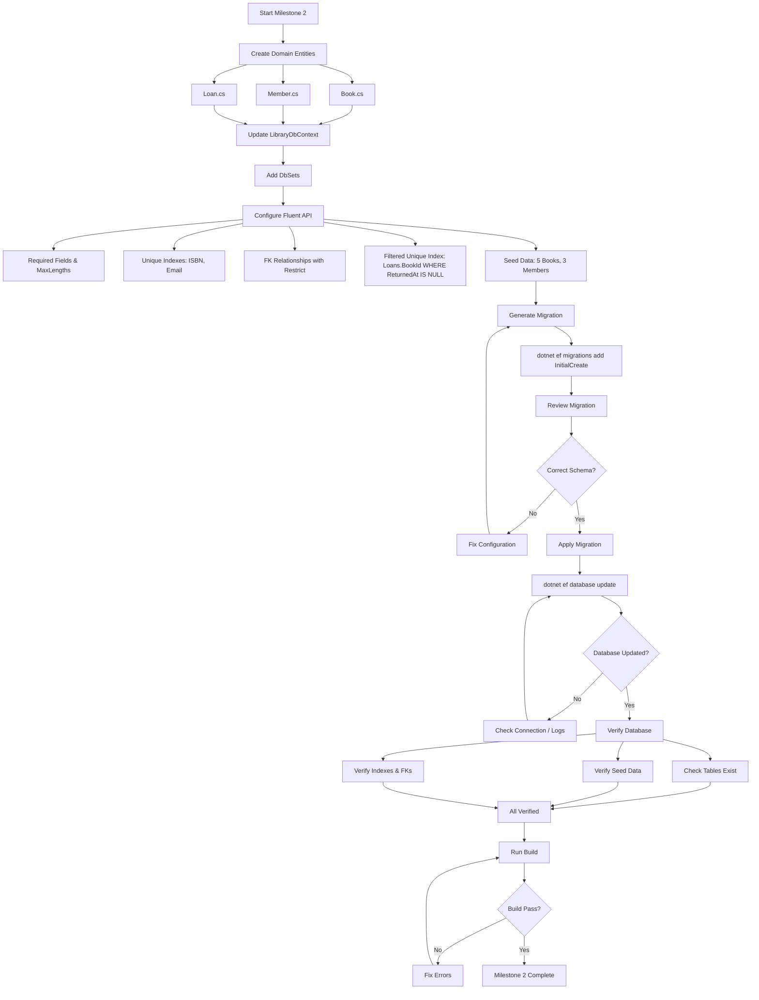
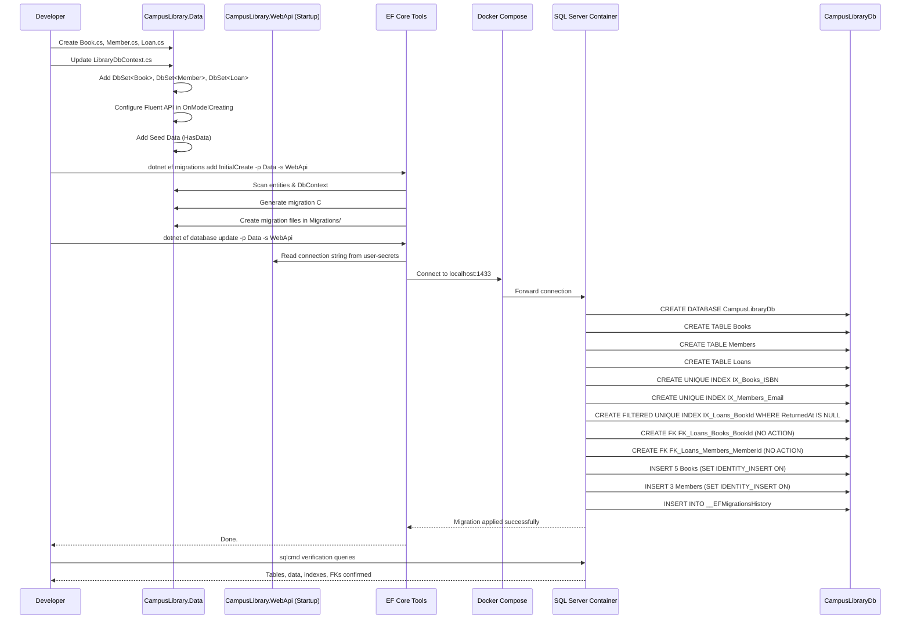
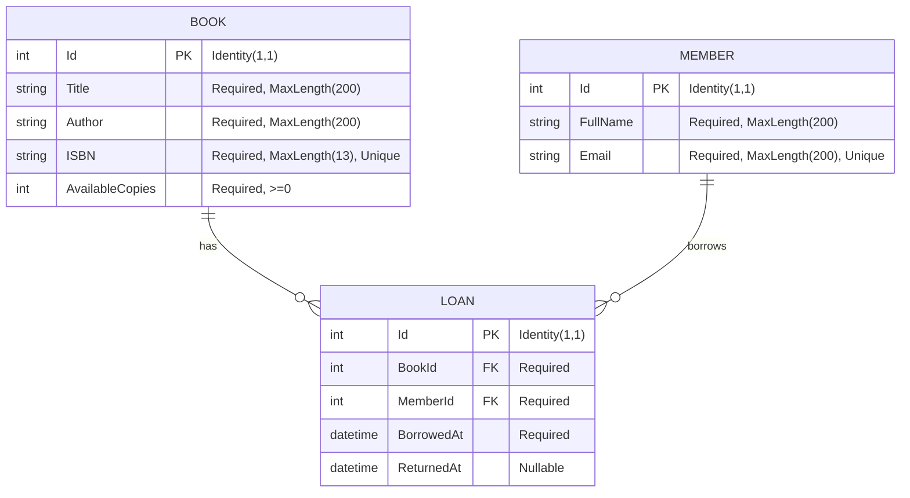
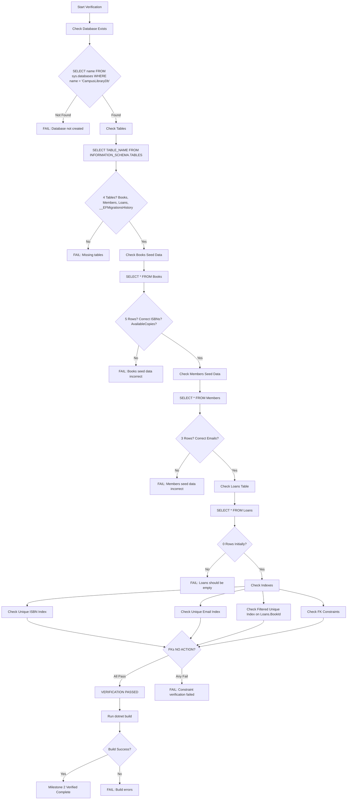

# Flowcharts — Milestone 2 Entity Framework Core

## Feature Logic Flowchart



## Sequence Diagram — EF Core Migration & Database Setup



## ER Diagram — Database Schema



## Migration Operations Flow

```mermaid
flowchart TD
    A[dotnet ef migrations add InitialCreate] --> B[EF Core Scans Assembly]
    B --> C[Discovers LibraryDbContext]
    C --> D[Analyzes DbSets: Books, Members, Loans]
    D --> E[Processes OnModelCreating]
    
    E --> F[Book Config]
    F --> F1[PK: Id]
    F --> F2[Required: Title, Author, ISBN, AvailableCopies]
    F --> F3[MaxLength: Title(200), Author(200), ISBN(13)]
    F --> F4[Unique Index: IX_Books_ISBN]
    F --> F5[Relationship: Book 1:0..1 Loan]
    
    E --> G[Member Config]
    G --> G1[PK: Id]
    G --> G2[Required: FullName, Email]
    G --> G3[MaxLength: FullName(200), Email(200)]
    G --> G4[Unique Index: IX_Members_Email]
    G --> G5[Relationship: Member 1:* Loans]
    
    E --> H[Loan Config]
    H --> H1[PK: Id]
    H --> H2[Required: BorrowedAt]
    H --> H3[Optional: ReturnedAt]
    H --> H4[FK: BookId -> Books.Id (Restrict)]
    H --> H5[FK: MemberId -> Members.Id (Restrict)]
    H --> H6[Filtered Unique Index: IX_Loans_BookId WHERE ReturnedAt IS NULL]
    H --> H7[Index: IX_Loans_MemberId]
    
    E --> I[Seed Data]
    I --> I1[5 Books with IDs 1-5]
    I --> I2[3 Members with IDs 1-3]
    
    F1 & F2 & F3 & F4 & F5 & G1 & G2 & G3 & G4 & G5 & H1 & H2 & H3 & H4 & H5 & H6 & H7 & I1 & I2 --> J[Generate Up/Down Methods]
    J --> K[Create Migration Files]
    
    K --> L[dotnet ef database update]
    L --> M[Connect to SQL Server]
    M --> N[Create Database]
    N --> O[Execute Up Migration]
    O --> O1[CREATE TABLE Books]
    O --> O2[CREATE TABLE Members]
    O --> O3[CREATE TABLE Loans]
    O --> O4[CREATE INDEXES]
    O --> O5[CREATE FOREIGN KEYS]
    O --> O6[INSERT SEED DATA]
    O --> O7[INSERT MIGRATION HISTORY]
    
    O1 & O2 & O3 & O4 & O5 & O6 & O7 --> P[Migration Complete]
```

## Verification Flowchart



## Project Structure After Milestone 2

```mermaid
flowchart LR
    subgraph Data[CampusLibrary.Data]
        Entities[Entities/]
        Entities --> Book[Book.cs]
        Entities --> Member[Member.cs]
        Entities --> Loan[Loan.cs]
        Context[LibraryDbContext.cs]
        Migrations[Migrations/]
        Migrations --> Mig1[20261107122452_InitialCreate.cs]
        Migrations --> Mig2[20261107122452_InitialCreate.Designer.cs]
        Migrations --> Snapshot[LibraryDbContextModelSnapshot.cs]
    end
    
    subgraph WebApi[CampusLibrary.WebApi]
        Program[Program.cs]
        DI[DI: AddDbContext<LibraryDbContext>]
    end
    
    subgraph WebMvc[CampusLibrary.WebMvc]
        Program2[Program.cs]
        DI2[DI: AddDbContext<LibraryDbContext>]
    end
    
    subgraph DB[(SQL Server in Docker)]
        Tables[Tables]
        Tables --> Books[Books]
        Tables --> Members[Members]
        Tables --> Loans[Loans]
        Tables --> History[__EFMigrationsHistory]
    end
    
    Data -->|ProjectReference| WebApi
    Data -->|ProjectReference| WebMvc
    WebApi -->|Connection String| UserSecrets[User Secrets]
    WebMvc -->|Connection String| UserSecrets
    UserSecrets -->|localhost:1433| DB
    EF[EF Core Tools] -->|Migrations| Data
    EF -->|database update| DB
```