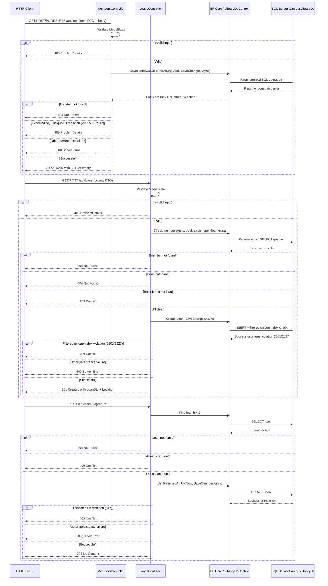

# Flowcharts — Members and Loans API

## Feature Logic
```mermaid
flowchart TD
    A[HTTP Request to Members/Loans API] --> B{Route valid?}
    B -->|No| C[404 Not Found]
    B -->|Yes| D{HTTP Method + Route}
    
    %% Members
    D -->|GET /api/members| E[Query Members AsNoTracking, project MemberDto]
    Q[Unexpected persistence failure; server error response]
    
    E --> F[200 OK with member DTO array]
    
    D -->|GET /api/members/{id}| G[Find member by ID]
    G --> H{Member found?}
    H -->|No| I[404 Not Found]
    H -->|Yes| J[200 OK with MemberDto]
    
    D -->|POST /api/members| K{ModelState valid?}
    K -->|No| L[400 Bad Request]
    K -->|Yes| M{Email already exists?}
    M -->|Yes| N[409 Conflict]
    M -->|No| O[Create member, save changes]
    O --> P{Unique violation 2601/2627?}
    P -->|Expected unique violation| N
    P -->|Other persistence failure| Q
    O -->|Saved| R1[201 Created with Location + MemberDto]
    
    D -->|PUT /api/members/{id}| R{ModelState valid?}
    R -->|No| L
    R -->|Yes| S[Find member by ID]
    S --> T{Member found?}
    T -->|No| I
    T -->|Yes| U[Update fields, save changes]
    U --> V{Unique violation 2601/2627?}
    V -->|Expected unique violation| N
    V -->|Other persistence failure| Q
    U -->|Saved| W[204 No Content]
    
    D -->|DELETE /api/members/{id}| X[Find member by ID]
    X --> Y{Member found?}
    Y -->|No| I
    Y -->|Yes| Z{Has loan history?}
    Z -->|Yes| AA[409 Conflict; preserve loans]
    Z -->|No| AB[Remove member, save changes]
    AB --> AC{FK violation 547?}
    AC -->|Expected FK violation| N
    AC -->|Other persistence failure| Q
    AB -->|Saved| AD[204 No Content]
    
    %% Loans
    D -->|GET /api/loans| AE[Query Loans AsNoTracking, project LoanDto with book/member summary]
    AE --> AF[200 OK with loan DTO array]
    
    D -->|GET /api/loans/{id}| AG[Find loan by ID]
    AG --> AH{Loan found?}
    AH -->|No| I
    AH -->|Yes| AI[200 OK with LoanDto]
    
    D -->|POST /api/loans| AJ{ModelState valid?}
    AJ -->|No| L
    AJ -->|Yes| AK{Member exists?}
    AK -->|No| AL[404 Not Found]
    AK -->|Yes| AM{Book exists?}
    AM -->|No| AN[404 Not Found]
    AM -->|Yes| AO{Open loan for book?}
    AO -->|Yes| AP[409 Conflict]
    AO -->|No| AR[Create loan with BorrowedAt=UtcNow, save]
    AR --> AS{SQL unique violation 2601/2627?}
    AS -->|Expected unique violation| AP
    AS -->|Other persistence failure| Q
    AR -->|Saved| AT[201 Created with Location + LoanDto]
    
    D -->|POST /api/loans/{id}/return| AU[Find loan by ID]
    AU --> AV{Loan found?}
    AV -->|No| I
    AV -->|Yes| AW{Already returned?}
    AW -->|Yes| AX[409 Conflict]
    AW -->|No| AY[Set ReturnedAt=UtcNow, save]
    AY --> AZ{SQL FK violation 547?}
    AZ -->|Expected FK violation| N
    AZ -->|Other persistence failure| Q
    AY -->|Saved| BA[204 No Content]
```

## API/Database Sequence


## Entity Relationship Diagram
```mermaid
erDiagram
    Book ||--o{ Loan : contains
    Member ||--o{ Loan : has
    Loan }o--|| Book : references
    Loan }o--|| Member : references

    Book {
        int Id PK
        string Title
        string Author
        string ISBN UK
        int AvailableCopies
    }

    Member {
        int Id PK
        string FullName
        string Email UK
    }

    Loan {
        int Id PK
        int BookId FK
        int MemberId FK
        DateTime BorrowedAt
        DateTime? ReturnedAt
    }

    %% Constraints
    Book ||--|| Loan : "at most one open loan per book"
    Loan {
        "Filtered unique index: BookId where ReturnedAt IS NULL"
    }
```