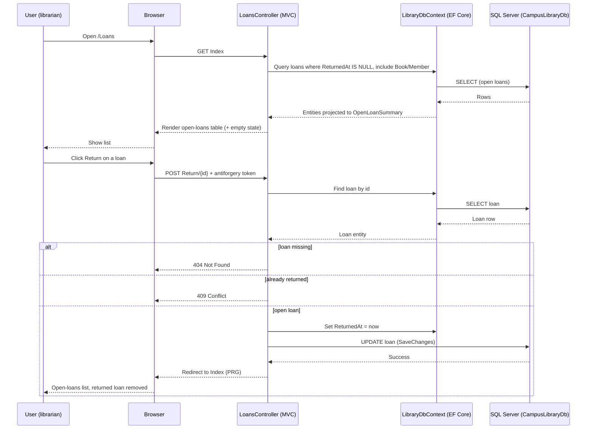

# Milestone 5 — MVC Loans: Diagrams

## Feature Logic (flowchart TD)

```mermaid
flowchart TD
    A[User opens /Loans] --> B[GET Index action]
    B --> C{Open loans exist?}
    C -- No --> D[Render empty-state card]
    C -- Yes --> E[Render table: Book, Author, Member, Borrowed at, Return button]

    E --> F[User clicks Return on a loan]
    F --> G[POST Return/{id} with antiforgery token]
    G --> H{Antiforgery valid?}
    H -- No --> I[400 / invalid request]
    H -- Yes --> J{Loan exists?}
    J -- No --> K[404 Not Found]
    J -- Yes --> L{Already returned?}
    L -- Yes --> M[409 Conflict, no change]
    L -- No --> N[Set ReturnedAt = now, SaveChanges]
    N --> O{Save succeeded?}
    O -- FK conflict 547 --> P[409 Conflict]
    O -- Yes --> Q[Redirect to Index PRG]
    Q --> E

    style D fill:#e9f7ef,stroke:#2e7d32
    style M fill:#fdecea,stroke:#c62828
    style P fill:#fdecea,stroke:#c62828
    style I fill:#fff3e0,stroke:#ef6c00
    style K fill:#fff3e0,stroke:#ef6c00
```

## Communication (sequenceDiagram)


