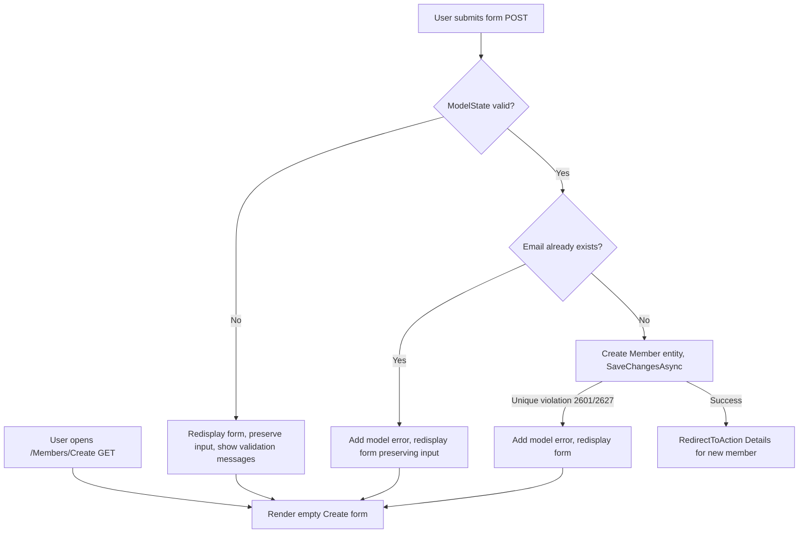

# Flowcharts — Members MVC Slice

## flowchart TD — MembersController Create (add member) logic



## flowchart TD — MembersController Details logic

```mermaid
flowchart TD
    A[User navigates /Members/Details/<id>] --> B{Member found?}
    B -->|No| C[Return 404 NotFound]
    B -->|Yes| D[Load member with Loans.Include(Book)]
    E[Render Details: name, email, borrowing history table]
    F{Any loans?} -->|No| G[Show empty state: no borrowing history]
    F -->|Yes| H[Show loan rows with Open/Returned badge]
```

## sequenceDiagram — Members MVC communication

```mermaid
sequenceDiagram
    participant Browser
    participant Controller as MembersController
    participant DB as LibraryDbContext (EF Core / SQL Server)

    Browser->>Controller: GET /Members
    Controller->>DB: db.Members.OrderBy(...).ToListAsync()
    DB-->>Controller: member summaries
    Controller-->>Browser: Index view (members list)

    Browser->>Controller: GET /Members/Create
    Controller-->>Browser: empty Create form

    Browser->>Controller: POST /Members/Create (form)
    Controller->>Controller: ModelState validation
    alt invalid
        Controller-->>Browser: redisplay form, input preserved, validation messages
    else valid
        Controller->>DB: db.Members.AnyAsync(email)
        alt duplicate
            Controller-->>Browser: conflict error, form redisplayed
        else unique
            Controller->>DB: db.Members.Add(member); SaveChangesAsync()
            DB-->>Controller: member inserted with id
            Controller-->>Browser: 302 redirect to /Members/Details/<id>
        end
    end

    Browser->>Controller: GET /Members/Details/<id>
    Controller->>DB: db.Members.Include(Loans).ThenInclude(Book).FirstOrDefaultAsync(id)
    alt missing
        DB-->>Controller: null
        Controller-->>Browser: 404 NotFound
    else found
        DB-->>Controller: member + loans
        Controller-->>Browser: Details view (name, email, borrowing history)
    end
```

## erDiagram — database tables involved (unchanged schema)

```erDiagram
Member ||--o{ Loan : has
Book ||--| Loan : at most one open
Member {
    int Id PK
    string FullName
    string Email UK
}
Loan {
    int Id PK
    int BookId FK
    int MemberId FK
    DateTime BorrowedAt
    DateTime? ReturnedAt
}
Book {
    int Id PK
    string Title
    string Author
    string ISBN UK
}
```