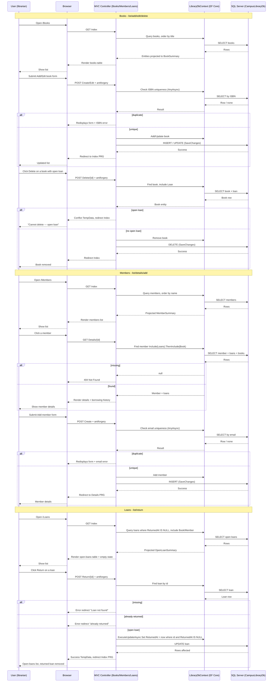

# Milestone 5 — MVC Admin: Diagrams

## Feature Logic (flowchart TD)

```mermaid
flowchart TD
    A[User opens /Books] --> B[GET Books/Index]
    B --> C{Books exist?}
    C -- No --> D[Render empty list]
    C -- Yes --> E[Render books table: Title, Author, ISBN, Copies, Add/Edit/Delete]

    E --> F[User clicks Add book]
    F --> G[GET Books/Create]
    G --> H[Render add-book form]
    H --> I[User submits form]
    I --> J[POST Books/Create + antiforgery]
    J --> K{ModelState valid?}
    K -- No --> L[Redisplays form with validation errors, input preserved]
    K -- Yes --> M{ISBN already exists?}
    M -- Yes --> N[Add ISBN model error, redisplays form]
    M -- No --> O[Create book, SaveChanges]
    O --> P{Save succeeded?}
    P -- Unique violation 2601/2627 --> N
    P -- Yes --> Q[Redirect to Index PRG]
    Q --> E

    E --> R[User clicks Edit on a book]
    R --> S[GET Books/Edit/{id}]
    S --> T{Book exists?}
    T -- No --> U[404 Not Found]
    T -- Yes --> V[Render edit form prefilled]
    V --> W[User submits form]
    W --> X[POST Books/Edit/{id} + antiforgery]
    X --> Y{ModelState valid and id matches?}
    Y -- No --> Z[NotFound or redisplays form]
    Y -- Yes --> AA{ISBN duplicated on another book?}
    AA -- Yes --> AB[Add ISBN model error, redisplays form]
    AA -- No --> AC[Update book fields, SaveChanges]
    AC --> AD{Save succeeded?}
    AD -- Unique violation --> AB
    AD -- Yes --> AE[Redirect to Index PRG]
    AE --> E

    E --> AF[User clicks Delete on a book]
    AF --> AG[POST Books/Delete/{id} + antiforgery]
    AG --> AH{Book exists?}
    AH -- No --> AI[404 Not Found]
    AH -- Yes --> AJ{Open loan exists?}
    AJ -- Yes --> AK[Block delete, conflict TempData, redirect to Index]
    AJ -- No --> AL[Remove book, SaveChanges]
    AL --> AM{Save succeeded?}
    AM -- FK violation 547 --> AN[Conflict TempData, redirect to Index]
    AM -- Yes --> AO[Redirect to Index PRG]
    AO --> E

    style L fill:#fff3e0,stroke:#ef6c00
    style N fill:#fff3e0,stroke:#ef6c00
    style U fill:#fff3e0,stroke:#ef6c00
    style Z fill:#fff3e0,stroke:#ef6c00
    style AK fill:#fdecea,stroke:#c62828
    style AN fill:#fdecea,stroke:#c62828
```

```mermaid
flowchart TD
    A[User opens /Members] --> B[GET Members/Index]
    B --> C{Members exist?}
    C -- No --> D[Render empty list]
    C -- Yes --> E[Render members table: Full Name, Email]

    E --> F[User clicks Add member]
    F --> G[GET Members/Create]
    G --> H[Render add-member form]
    H --> I[User submits form]
    I --> J[POST Members/Create + antiforgery]
    J --> K{ModelState valid?}
    K -- No --> L[Redisplays form with validation errors, input preserved]
    K -- Yes --> M{Email already exists?}
    M -- Yes --> N[Add email model error, redisplays form]
    M -- No --> O[Create member, SaveChanges]
    O --> P{Save succeeded?}
    P -- Unique violation 2601/2627 --> N
    P -- Yes --> Q[Redirect to Details PRG]
    Q --> R[Render member details + borrowing history]

    E --> S[User clicks a member]
    S --> T[GET Members/Details/{id}]
    T --> U{Member exists?}
    U -- No --> V[404 Not Found]
    U -- Yes --> W[Render details with loan history]
```

```mermaid
flowchart TD
    A[User opens /Loans] --> B[GET Loans/Index]
    B --> C{Open loans exist?}
    C -- No --> D[Render empty-state card]
    C -- Yes --> E[Render table: Book, Author, Member, Borrowed at, Return button]

    E --> F[User clicks Return on a loan]
    F --> G[POST Loans/Return/{id} + antiforgery token]
    G --> H{Antiforgery valid?}
    H -- No --> I[400 invalid request]
    H -- Yes --> J{Loan exists?}
    J -- No --> K[Error redirect: Loan not found]
    J -- Yes --> L{Already returned?}
    L -- Yes --> M[Error redirect: already returned, no change]
    L -- No --> N[Set ReturnedAt = now where ReturnedAt IS NULL]
    N --> O{Rows affected?}
    O -- 0 --> M
    O -- >0 --> P[Success TempData, redirect to Index PRG]
    P --> E

    style D fill:#e9f7ef,stroke:#2e7d32
    style I fill:#fff3e0,stroke:#ef6c00
    style K fill:#fff3e0,stroke:#ef6c00
    style M fill:#fdecea,stroke:#c62828
```

## Communication (sequenceDiagram)



## Entity Relationship (erDiagram)

```mermaid
erDiagram
    Book ||--o{ Loan : contains
    Member ||--o{ Loan : has
    Loan }o--|| Book : linked_to
    Loan }o--|| Member : borrowed_by

    Book {
        int Id PK
        string Title
        string Author UK
        string ISBN UK
        int AvailableCopies
    }

    Member {
        int Id PK
        string FullName
        string Email UK
    }

    Loan {
        int Id PK
        int BookId FK
        int MemberId FK
        datetime BorrowedAt
        datetime? ReturnedAt
    }

    %% Constraint: at most one open loan per book
    %% (filtered unique index on Loan.BookId where ReturnedAt IS NULL)
```