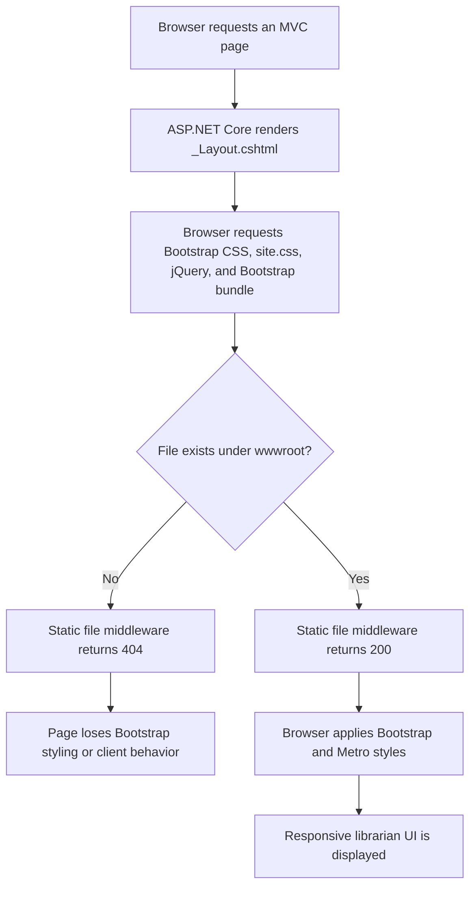
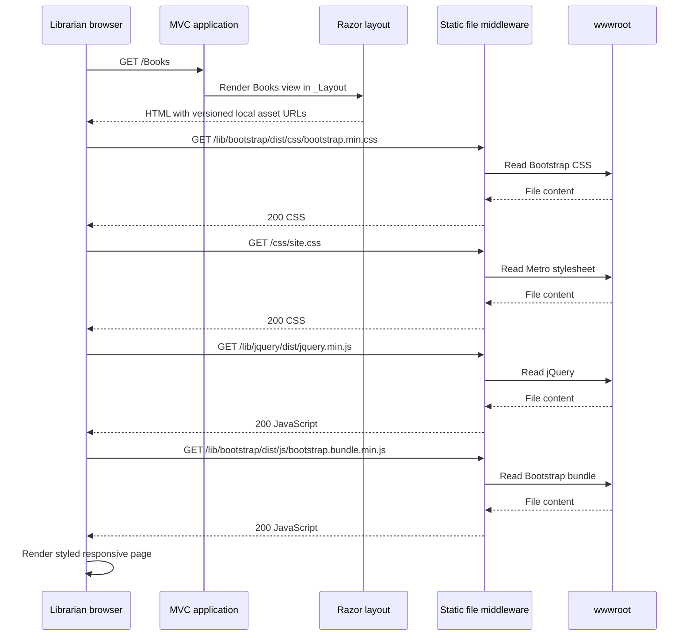

# Restore MVC Client Assets — Flowcharts

## Feature logic

## Component communication

## Database changes

No database tables or relationships changed, so no entity-relationship diagram is required for this asset-only fix.
